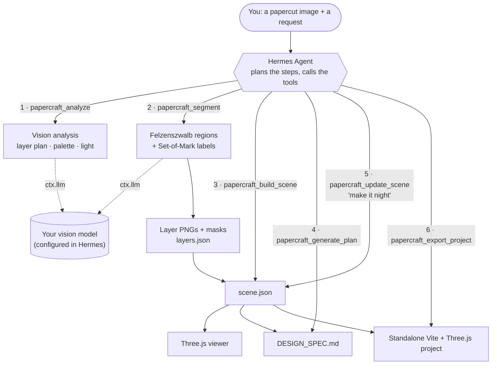
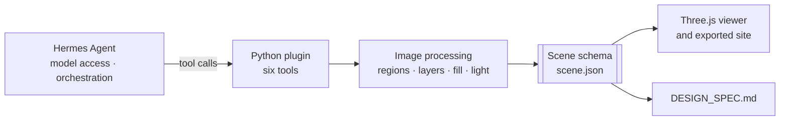
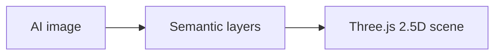
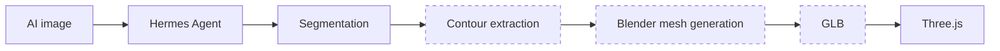

<div align="center">

# PaperCraft 3D

### From AI Art to Interactive 3D Scenes

**One Image. Multiple Layers. A Living 3D Scene.**

[](https://github.com/NousResearch/hermes-agent)
[](#option-b-claude-code)
[](https://threejs.org)
[](pyproject.toml)
[](LICENSE)

[Quick Start](#quick-start) · [How It Works](#how-it-works) · [Architecture](#architecture) ·
[Status](#current-status--limitations) · [Roadmap](#roadmap-toward-a-blender-pipeline) ·
[Documentation](#documentation)

</div>

PaperCraft 3D is an open-source [Hermes Agent](https://github.com/NousResearch/hermes-agent) plugin
that turns AI-generated papercut artwork into structured depth layers, an interactive Three.js scene
and an editable development specification.

It does more than add a visual 3D effect to a picture. It tries to establish an AI-to-3D workflow you
can **verify, edit and run again**. Every step writes plain files that you can inspect, and every model
answer is checked before it is used. You end up with code and assets you own.

> **What you get today is a 2.5D layered scene:** transparent cut-out planes at different depths, not
> a 3D mesh with full topology and back faces. Turning those layers into real geometry through Blender
> is the [long-term direction](#roadmap-toward-a-blender-pipeline).

## Showcase

<!-- Real end-to-end captures only. File names and how to capture them: docs/media/README.md -->

| Original AI artwork | Semantic layer map | Interactive Three.js preview |
|:---:|:---:|:---:|
| *Capture pending:* `docs/media/01-original.webp` | *Capture pending:* `docs/media/02-layer-map.png` | *Capture pending:* `docs/media/03-preview.png` |

More captures are planned: the **exploded layer view**, **day vs night lighting**, and **natural-language
scene editing** (a chat request, then the viewer reloading to the new revision). The
[shot list](docs/media/README.md) describes each one.

This repository does not show the synthetic test fixture as a result. That fixture is drawn by a
script to test the pipeline against known layers; it is not output of the AI workflow. The showcase
will only contain real end-to-end runs, labelled with the host and plugin version that produced them.

## Why PaperCraft 3D?

AI-generated artwork may look dimensional, but it usually lacks editable geometry, meaningful depth
separation and a reusable scene structure. A papercut illustration is a good starting point because
it is already made of layers: sky, distant hills, a village, a framing tree, flowers in front. They are
simply flattened into one image.

PaperCraft 3D tries to recover that structure and keep it in a form a developer can work with:

- **Semantic layers instead of a depth guess.** Each layer is a named part of the scene, such as
  `sky` or `harbor_village`, with its own transparent PNG and mask, and the hidden area behind nearer
  layers filled in.
- **A scene contract instead of a one-off render.** `scene.json` follows a JSON Schema that the plugin,
  the viewer and the spec generator all share.
- **An agent workflow instead of a black box.** The model plans and labels; the plugin measures, checks
  and refuses to fake success. When a step fails, it says so.

## How It Works

Hermes Agent drives the whole flow. It reads your request, calls the six PaperCraft tools in order, and
lends the plugin its configured vision model through `ctx.llm`. The plugin does the image processing
and validation on your machine.



1. **Analyse.** The vision model plans 3–8 depth layers, their order and occlusion, the palette, the
   light direction and the glowing elements. The plugin checks the reply against a schema and the
   palette against the real pixels.
2. **Segment.** The plugin divides the image into regions along the paper cut lines and numbers them.
   The vision model says which layer each number belongs to (Set-of-Mark labelling), and unclear
   regions get a second, finer round.
3. **Build.** The layers become a `scene.json` with depths, camera and parallax limits that keep gaps
   hidden, and day and night lighting.
4. **Document, edit, export.** A design spec is generated from the scene. Plain-language edits become
   validated scene patches. The result exports as a standalone web project.

## Core Features

The plugin provides six tools. The agent calls them for you; you can also name them in your request.

| Tool | What it does |
|---|---|
| `papercraft_analyze` | Validates the image, creates a project and writes `analysis.json`: layers, occlusion, palette, light, camera and glowing elements. The model's reply is schema-checked and repaired once if needed, and its colours are checked against the pixels. |
| `papercraft_segment` | Produces full-size transparent layer PNGs, masks and `layers.json`, with hidden areas filled in. Restacking the layers reproduces the source exactly. Wrong regions can be corrected with painted masks, without calling the model again. |
| `papercraft_build_scene` | Writes a schema-valid `scene.json`. Tilt and parallax limits are derived from the filled margin so gaps never show, light is calibrated to the painted art, and glow maps cover only the bright pixels of lamps, windows and the sun. |
| `papercraft_generate_plan` | Writes `DESIGN_SPEC.md` (Traditional Chinese or English). Every number is read from `scene.json` and re-checked against it, and your own notes survive regeneration. |
| `papercraft_update_scene` | Applies a plain-language edit ("make it night with cold moonlight") as a validated, atomic patch, with protected paths, history and undo. The spec's change log updates and an open viewer reloads. |
| `papercraft_export_project` | Exports a standalone Vite + React + Three.js project with relative paths only. You build it with `npm ci && npm run build`. |

**Verification at a glance.** Each level is reported separately; see
[Current Status](#current-status--limitations) for the details.

| Tool | Implemented | Automated tests | Claude Code host, real images | Hermes, real vision model |
|---|:---:|:---:|:---:|:---:|
| `papercraft_analyze` | ✅ | ✅ | ✅ | ✅ |
| `papercraft_segment` | ✅ | ✅ | ✅ | ⚠️ ran; quality review open |
| `papercraft_build_scene` | ✅ | ✅ | ✅ | not yet run |
| `papercraft_generate_plan` | ✅ | ✅ | ✅ | not yet run |
| `papercraft_update_scene` | ✅ | ✅ | ✅ | not yet run |
| `papercraft_export_project` | ✅ | ✅ | ✅ | not yet run |

## Quick Start

You need Python 3.11+. Node.js 20.19+ is only needed to preview scenes and build the exported site.
Pick the host you use.

### Option A: Hermes Agent

Requires Hermes Agent 0.22 or newer, with a **vision-capable model** configured.

```bash
hermes plugins install than0112/papercut-plugin --enable
```

Accept the prompt to install the Python dependencies (Pillow, numpy, jsonschema, scipy,
scikit-image). Then restart the gateway so it loads the plugin, and reconnect Hermes Desktop:

```bash
hermes gateway restart
```

```bash
hermes plugins doctor papercraft-3d
```

`doctor` should report 6 tools. Hermes keeps plugin tools behind Tool Search, so if the agent says it
cannot see them, ask it to `tool_search` for "papercraft"
([details](docs/INSTALLATION.md#finding-the-tools-in-a-conversation)).

### Option B: Claude Code

In Claude Code, Claude itself is the vision model, so no API key is needed.

```bash
claude plugin marketplace add than0112/papercut-plugin
```

```bash
claude plugin install papercraft-3d@papercraft
```

Start a new session. On first use, Claude asks to install the imaging libraries into the plugin's own
virtualenv. On Windows, if `python3` does not start Python, run
`/plugin configure papercraft-3d@papercraft` and set the Python command to `python` or `py`.

### First run

Attach or point to a papercut image and say:

> Turn this papercut image into an interactive Three.js scene with PaperCraft 3D: analyze it, split it
> into layers, build the scene and write the design spec. Show me the layer map before building.

Each result names the next step. When the scene is built, the result also gives the exact command to
preview it in the bundled viewer. Every result carries `pluginVersion`, so you always know which code
answered.

Detailed setup, settings, preview commands for Windows, macOS and Linux, and troubleshooting are in
[docs/INSTALLATION.md](docs/INSTALLATION.md).

## Example Workflow

Every project is a folder of plain files. The table below shows what a run produces, and what a
developer can do with each output.

| Output | What it contains | What you can do with it |
|---|---|---|
| `analysis.json` | The layer plan (ids, order, depth estimates, occlusion), palette, light, camera and emitters, plus a palette check against the pixels | Review the model's understanding before any pixels are cut; rerun with a different `max_layers` or brief |
| `layers.json` | Per-layer coverage, hidden-area fill ratio, confidence, labelling record and manual edits | Audit the segmentation; find layers that need a mask correction |
| `assets/*.png`, `masks/*.png` | One full-size transparent PNG and one mask per layer | Use the cut-outs in any engine or editor; they restack to the original exactly |
| `review/layer_map.png` | The layers as solid colours, plus the overlay and the numbered regions the model saw | Check the result at a glance; spot a wrong region |
| `scene.json` | Depths, camera, safe tilt and parallax limits, lighting and presets, materials and glow maps | Load it in the viewer, or in your own Three.js code; it is validated against `schemas/scene.schema.json` |
| `DESIGN_SPEC.md` | A design spec (visual concept, structure, lighting, materials, interaction, implementation, change log) generated from the scene | Hand it to a team; it stays consistent with `scene.json` because both come from the same data |
| `export/<name>-web/` + `.zip` | A standalone Vite + React + Three.js project | `npm ci && npm run build`, then host `dist/` anywhere |

A real Hermes run on a 1672 × 941 lighthouse-harbour papercut (plugin 0.9.1, `gpt-6.1-sol`) produced
these seven layers:

| Order | Layer | Share of the image |
|---:|---|---:|
| 0 | `sky`: sunset, light rays and clouds | 27.5% |
| 1 | `distant_coast`: far hills and the far shore | 3.4% |
| 2 | `sea`: water, waves and two sailboats | 13.9% |
| 3 | `left_headland`: the lighthouse cape, path and rocks | 15.6% |
| 4 | `harbor_village`: houses, pier and fishing boats | 5.2% |
| 5 | `framing_tree`: the large tree on the left | 10.3% |
| 6 | `foreground`: flowers, fence, beach and rocks | 24.3% |

In that run the sailboats were placed in the wrong layers. This is exactly the kind of error the
`layer_map.png` review exists for, and a painted mask corrects it. The cause has been addressed in
0.9.2; see [Current Status](#current-status--limitations).

## Architecture



- **Hermes Agent** handles model calls and tool orchestration. The plugin never holds API keys; it asks
  your configured vision model through `ctx.llm`.
- **The Python plugin** does the image processing, validation and output: region computation, layer
  extraction, hidden-area fill, light calibration, patch checks and export. It runs no shell commands.
- **The JSON Schema** (`schemas/scene.schema.json`) is the shared source of truth. The plugin validates
  against it, the viewer validates the same file at load time, and the spec is generated from a
  validated scene.
- **Three.js** provides the interactive view: tilt, parallax, an exploded view and lighting presets.
- **The design spec** stays in sync with the scene parameters. It records the scene's fingerprint, so a
  stale spec is detected.

The same pipeline also runs as a **Claude Code plugin**, with Claude as the vision model. The
algorithms, error handling, colour checks, lighting model, region merging and security design are in
[docs/ARCHITECTURE.md](docs/ARCHITECTURE.md).

## Current Status & Limitations

**Version 0.9.2.** All six tools are implemented. **176 automated tests** pass; they use a fake vision
model and an oracle labeller, plus replies recorded from real runs. The per-file breakdown is in
[TEST_REPORT.md](docs/TEST_REPORT.md).

**Verified in a real Hermes install** (Hermes 0.22.7 on Windows, plugin 0.9.1):

- The plugin installed. `hermes plugins validate` and `hermes plugins doctor` passed with exit code 0,
  and all six tools registered.
- `papercraft_analyze` ran with a real vision model (`openai-codex / gpt-6.1-sol`).
- `papercraft_segment` ran with a real vision model and produced a true layered result (not the preview
  fallback). That result had seven layer PNGs, seven masks and `layers.json`, and the second labelling
  round ran in three batches.
- **The segmentation quality has not passed human review.** The sailboats landed in the wrong layers.
- `papercraft_build_scene`, `papercraft_generate_plan`, `papercraft_update_scene` and
  `papercraft_export_project` have **not yet been run in Hermes**.

So not all six tools have been accepted in a real Hermes environment yet.

**Verified with the Claude Code host** (Claude as the vision model, plugin 0.8–0.9):

- Analysis, segmentation, scene building, the spec and export ran end to end on three real papercuts:
  a lighthouse harbour, a Japanese village and a night forest. The village run also applied a
  natural-language night edit with `papercraft_update_scene`.
- Claude reported its own layer mistakes. In one run it corrected a layer with a painted mask.
- The analyses and labels from these runs are recorded as regression tests.

**Changes since the Hermes run (0.9.2, covered by automated tests and an offline evaluation):**

- Merged regions whose pieces are clearly different colours are now split before numbering. This is
  the cause of the sailboat error.
- On the three real images, the share of numbered-region pixels that belong to another layer fell from
  0.019 to 0.015 on the lighthouse and stayed level on the village and the forest.

**Limitations:**

- **2.5D, not a mesh.** Layers are flat transparent planes. There are no back faces, so the view is
  limited to a safe tilt range.
- **Layer quality depends on the model and the art.** Very detailed images force coarse regions. Pieces
  of nearly the same colour (pink blossoms against a pink sky) and objects smaller than a numbered
  region can land in the wrong layer. Always check `review/layer_map.png`; painted masks fix errors.
- **Hidden areas are filled, not recovered.** What a nearer layer covered is interpolated from the
  layer's own pixels, within a margin, and painted shadows stay where the artist put them.
- **Images up to 10 MB and 40 megapixels**, in PNG, JPEG or WebP.

## Roadmap: Toward a Blender Pipeline

**Today:**



**Planned (not implemented yet):**



The layers and masks already describe *what* each part of the scene is and *where* it sits. The next
stage turns that description into geometry. The planned building blocks:

| Planned | Purpose |
|---|---|
| Mask-to-contour conversion | Clean outlines from each layer mask |
| SVG / shape extraction | Editable vector shapes for each cut-out |
| Mesh extrusion | Paper-thickness solids instead of flat planes |
| Topology validation | Watertight, manifold meshes that later tools can trust |
| Procedural materials | Paper fibre, edge darkening and translucency |
| Automated lighting | Scene lights derived from the analysed light and emitters |
| GLB export | A standard asset for engines, AR and the web |
| Three.js integration | Loading the GLB into the same viewer and export |

Blender matters here for more than the GLB file. It makes the geometry **editable, stable and ready for
further production**: an artist can open the result, fix a shape, add a bevel or re-light it. The plugin
does not have to solve every case perfectly.

Before that, the near-term work:

- Complete the Hermes acceptance of `build_scene`, `generate_plan`, `update_scene` and `export_project`.
- Add real showcase captures and a demo video.
- Submit the Hermes plugin catalog entry ([draft](docs/catalog/papercraft-3d.yaml)).
- Handle objects smaller than a numbered region.

## Documentation

| Document | Contents |
|---|---|
| [docs/INSTALLATION.md](docs/INSTALLATION.md) | Setup for both hosts, settings, preview and build, troubleshooting, development setup |
| [docs/ARCHITECTURE.md](docs/ARCHITECTURE.md) | System design, the analysis, segmentation, scene and editing pipelines, security and privacy |
| [docs/TEST_REPORT.md](docs/TEST_REPORT.md) | Automated test coverage and the results of real runs |
| [docs/HERMES_TEST_PLAN.md](docs/HERMES_TEST_PLAN.md) | The step-by-step acceptance procedure in Hermes (Traditional Chinese) |
| [docs/SEGMENTATION_HTTP.md](docs/SEGMENTATION_HTTP.md) | The contract for plugging in your own segmentation service |
| [docs/SUBMISSION.md](docs/SUBMISSION.md) | The Hermes Plugin Hackathon 2026 submission and disclosures |
| [docs/media/README.md](docs/media/README.md) | The showcase shot list |

## Contributing

Issues and pull requests are welcome.

- **Report a layering problem** with the project's `review/layer_map.png`, `layers.json` and
  `segmentation/regions.json` (and the source image, if you can share it). Real failure cases are the
  most valuable input this project gets.
- **Before a pull request,** run the test suite. The [development setup](docs/INSTALLATION.md#development-setup)
  explains how. If you change the viewer, also run `npm run build` in `viewer/`.
- **Two rules hold the design together.** Never return `"ok": true` for work that was not done.
  `schemas/scene.schema.json` is the contract, so update the schema and `viewer/src/types/scene.ts`
  together.

## 中文簡介

PaperCraft 3D 是 Hermes Agent 外掛，也可以在 Claude Code 使用。它把一張 AI 紙雕圖拆成有語意的深度圖層、可互動的 Three.js 場景、和場景數值一致的企劃書（`DESIGN_SPEC.md`），以及可以獨立建置的網頁專案。場景做好後可以用一句話修改，例如「改成夜晚、藍色月光」。

目前的成果是 2.5D 分層場景，還不是完整的 3D 模型，長期目標是透過 Blender 產生可編輯的幾何模型。安裝方式見上方 [Quick Start](#quick-start)，詳細說明見 [docs/INSTALLATION.md](docs/INSTALLATION.md)。

## License

[MIT](LICENSE) © 2026 youhong
