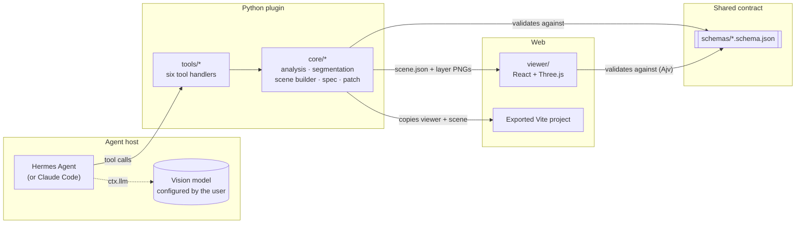

# Architecture and pipeline details

This document covers how PaperCraft 3D works inside. The [README](../README.md) has the overview,
[INSTALLATION.md](INSTALLATION.md) covers setup, and [TEST_REPORT.md](TEST_REPORT.md) has the measured
results.

- [System overview](#system-overview)
- [Repository layout](#repository-layout)
- [Tool results and errors](#tool-results-and-errors)
- [Analysis](#analysis)
- [Segmentation](#segmentation)
- [Scene building](#scene-building)
- [Design spec](#design-spec)
- [Editing a scene in plain language](#editing-a-scene-in-plain-language)
- [Preview and export](#preview-and-export)
- [Claude Code host](#claude-code-host)
- [Security and privacy](#security-and-privacy)

## System overview



- **Hermes** owns model access and orchestration. The plugin never handles API keys. It asks the
  user's configured vision model through `ctx.llm`, and the agent decides which tool to call next.
- **The Python plugin** does the measurable work: image validation, region computation, layer
  extraction, hidden-area fill, light calibration, spec rendering, patch validation and export. Every
  model reply is treated as untrusted input and validated before use.
- **`schemas/scene.schema.json`** is the single source of truth for a scene. The plugin validates
  against it, the viewer validates the same file at load time through Ajv, and the spec is rendered
  from a validated scene.
- **The Three.js viewer** renders the scene and is the only place where the scene is interactive.
  Viewer controls change the preview only; lasting changes go through `papercraft_update_scene`.
- **`DESIGN_SPEC.md`** is generated from `scene.json` and re-checked against it, so the document and
  the scene cannot drift apart.

## Repository layout

| Path | Contents |
|---|---|
| `plugin.yaml`, `__init__.py` | Hermes manifest and `register(ctx)`, which registers the six tools |
| `tools/` | One module per tool: argument checks, stage bookkeeping, the result summary |
| `core/` | The pipeline: `analysis`, `segmentation`, `segment_backends`, `scene_builder`, `spec`, `scene_patch`, `exporter`, `security`, `storage` |
| `schemas/` | JSON Schemas for `analysis.json`, `layers.json` and `scene.json` |
| `viewer/` | React + React Three Fiber viewer (Vite), also the template of the export |
| `claude/`, `.claude-plugin/`, `skills/` | The Claude Code host: MCP server, marketplace manifest, workflow skill |
| `templates/` | Structure notes for the design spec and the scene |
| `examples/make_synthetic_fixture.py` | Generates the synthetic test scene with known ground-truth layers |
| `tests/` | The automated suite, including recorded real-model replies (`tests/fixtures/`) |

## Tool results and errors

Every tool returns a JSON envelope:

```json
{"ok": true, "tool": "papercraft_segment", "pluginVersion": "0.9.2", "data": {}, "warnings": []}
```

```json
{"ok": false, "tool": "papercraft_segment", "pluginVersion": "0.9.2",
 "error": {"code": "segmentation_failed", "message": "...", "retryable": true, "details": {}}}
```

Error codes include `image_format`, `image_too_large`, `model_unavailable`, `model_output_invalid`,
`segmentation_failed`, `scene_invalid`, `asset_missing`, `viewer_build_failed`, `export_failed`,
`path_forbidden`, `precondition_failed` and `not_implemented` (see `core/errors.py`). Handlers never
raise into the host, and a failed stage writes nothing. `pluginVersion` makes it visible which code is
actually running.

## Analysis

1. The image is validated (PNG, JPEG or WebP, at most 10 MB and 40 megapixels, fully decoded) and
   copied read-only into a new project. A copy downscaled to 1536 px on its long side is sent to **the
   active Hermes model** through `ctx.llm`. If that model is text-only, Hermes routes the call to the
   configured vision model.
2. The reply must pass `schemas/analysis.schema.json` and semantic checks: unique ids and orders,
   `x0 < x1`, at most `max_layers` layers, and occlusion consistent with order. If it fails, the model
   gets **one** repair attempt that lists the exact errors. If that also fails, the tool returns
   `model_output_invalid` and writes no `analysis.json`.
3. Before the call, the plugin clusters the real pixels (k-means in CIE Lab, deterministic) into up to
   12 colours. It stores them in `measured.palette` and gives them to the model as candidates.
   Afterwards, every palette colour the model returns is checked against every colour that covers at
   least 0.2% of the pixels. The result is returned as `palette_check`, and colours that are not found
   become `needsReview` items.
4. `light.emitters` lists elements that should glow (a drawn sun, lanterns, lit windows), each with its
   layer, bounding box and colour, for the scene builder.
5. Every raw model reply is kept in `logs/analysis_reply_N.txt`, and each attempt is logged in
   `logs/process.jsonl`.

## Segmentation

1. **Regions on the user's machine.** Felzenszwalb graph segmentation runs on a 1024 px working copy
   and follows the paper cut lines. A Ward-style agglomerative merge then joins similar neighbours,
   cheapest first, recomputing region means after every merge. This leaves 40–120 significant regions,
   depending on the number of layers. A transitive threshold merge was dropped: on a real image it
   chained pink sky, blossoms, snow and rock into one region covering 50% of the picture.
   **Colour split:** on detailed art the merge must be coarse to stay within the number budget, so a
   region can still join clearly different pieces. One real example joined a white sail, the pink coast
   behind it and the sun's gold reflection. Its one number sat on the coast, so the sail was labelled as
   coast. Such regions are split again by colour group and connectivity before the numbers are drawn.
   The clearest cases go first, with at most 3 parts per region and at most 12 extra numbers.
2. **Labels from the vision model (Set-of-Mark).** The model gets the original image and a copy with
   each region outlined and numbered, plus the layer plan from `analysis.json`. It answers
   "region 12 → `red_bridge`". The answer is validated, with one repair round. Regions too small for a
   number inherit the layer of the neighbour they share the longest border with.
   - **Second round.** Regions the model marks as mixing layers (for example sky showing between
     blossoms) are split into smaller parts along the original fine segments. The model gets another
     image in which only those parts are bright and numbered (`review/refine_marks.png`).
   - **Colour check.** The model does not always notice a mixed region, so the plugin checks every
     labelled region itself. It splits the region into two colour groups. If one group matches an
     adjacent region of *another* layer much better than anything of its own layer, the region joins
     the second round (up to 3 extra regions; `labelling.autoFlagged` lists them). Lightness counts for
     half, so a cast shadow (a darker shade of the same paper) is not mistaken for another layer. With
     perfect labels on the synthetic fixture it flags nothing. On the real village image it caught the
     blossom-and-sky region the model had missed.
   - **Batches.** The second round is sent in batches of at most 36 numbered parts
     (`review/refine_marks.png`, `refine_marks_2.png`, …), each region's parts together, so the numbers
     stay readable. A failed batch keeps the first-round labels for its own regions only.
3. **Full-resolution edges.** The map is upsampled, and the pixels on layer boundaries are reassigned by
   local colour similarity. Isolated specks are removed.
4. **Hidden-area fill.** The farthest layer is completed everywhere. Every other layer except the
   nearest is extended by 5% of the image's long side behind nearer layers. The extension is filled by
   push-pull interpolation from the layer's own pixels, skipping the cast-shadow band. Owned pixels are
   never changed. `fill.marginPx` tells the scene builder how far layers may shift relative to each
   other before an unfilled gap could show.
5. **Review and correct.** Three review images are written:
   - `review/overlay.png`: the layers colour-coded over the art.
   - `review/layer_map.png`: the same layers as solid colours, which are unambiguous.
   - `review/marks.png`: the numbered regions the model saw.

   To fix a layer, paint a mask (white = belongs to the layer, same size as the source) and run
   segmentation again with `manual_masks` (`papercraft_segment_correct` in Claude Code). The previous
   ownership is reused without calling the model again, and the change is recorded under
   `manualEdits`.

Measured with perfect labels on the synthetic fixture at 480–2400 px wide, the pipeline reaches
98.6–98.9% pixel accuracy, with every layer's IoU at 0.90 or higher. Restacking the layers reproduces the
source image pixel for pixel, and a test enforces this. These numbers measure the regions, edges and fill,
not the model. On real images, the result depends on how well the vision model labels the regions, so
always check `review/layer_map.png`.

`segmentation_backend: http` replaces the built-in pipeline with your own service. See
[SEGMENTATION_HTTP.md](SEGMENTATION_HTTP.md).

## Scene building

- **Depth.** The analysed `depthEstimate` values are scaled by `depth_spacing`, and the image is 8 world
  units tall.
- **Safety bounds.** Segmentation completed every layer `fill.marginPx` behind nearer layers. The
  camera tilt limit is the largest angle at which two overlapping layers shift by at most 60% of that
  margin. Parallax gets the other 40%. Both are rounded down, and `scene.limits` records the resulting
  shifts. A test recomputes them from `scene.json`.
- **Camera.** Orthographic by default, which preserves the original framing. Perspective is available.
  When the analysis suggested a different camera, the result says so.
- **Edges.** The viewer clips drawing to the back layer's rectangle, like the frame of a shadow box. It
  also extends every layer past the image edge by mirroring, so a moving layer never ends abruptly at
  the border.
- **Light.** The art already has painted light. Ambient plus key light is set to a total irradiance of
  about 3.0 (π gives the unlit texture colour), with 55% ambient and 45% directional for real shadows
  between layers. The key light's direction and colour come from the analysed azimuth, elevation and
  colour temperature. Night is cool moonlight with a backlight.
- **Glow.** For each analysed emitter, only pixels inside its box that are both bright and close to its
  colour glow. The box itself never glows. The hottest part of a light is usually drawn nearly white, so
  very bright pixels tinted towards the emitter's hue also glow when they connect to that colour, and a
  white centre fully enclosed by glow is filled in. Untinted white paper next to a lamp stays dark.
  `emissiveScale` makes lights brighter at night.

## Design spec

`papercraft_generate_plan` writes `DESIGN_SPEC.md` in Traditional Chinese (`zh-TW`) or English. It has
these sections:

- A. Visual concept
- B. Scene structure
- C. Lighting
- D. Materials and rendering
- E. Interaction
- F. Technical implementation
- G. Change log, added after the first edit

Every number is read from `scene.json` and re-checked against it. The spec records the scene's SHA-256
fingerprint, so a stale spec is detected. Text the user adds outside the generated sections is kept when
the spec is regenerated.

## Editing a scene in plain language

The agent turns the request into JSON Patch operations, and `papercraft_update_scene` handles the rest:

- **Validation.** Every path must be on an allow-list: lighting, presets, interaction, rendering, camera
  zoom and tilt, and layer depth, parallax and material. Assets, masks, the source image, ids,
  provenance and derived data are protected. The whole patch is checked against the scene schema and the
  semantic rules, and a failure writes nothing.
- **Conveniences.** Layers can be addressed by id (`/layers/red_bridge/depth`). `{"$preset": "night"}`
  copies a preset. Using `replace` on an optional field that is not set yet is treated as `add`.
- **Consistency.** If only the key light's colour changes, its stale colour temperature is dropped.
  Edited lighting is labelled `custom`.
- **Safety bounds.** If the edit would let layers shift past the filled margin, the plugin lowers
  whichever of tilt or parallax the user did not ask for, and reports it. If both were requested
  explicitly, the edit is refused with the numbers, unless `respect_limits=false`.
- **History.** Before each change, the previous scene is saved as `history/scene.rev<N>.json`, and
  `history/patches.jsonl` records the request, the operations, the diff and any adjustments.
  `revert_to` restores an older revision as a new one. `dry_run` shows the diff without writing.
- **Spec and viewer.** `DESIGN_SPEC.md` is regenerated and gains section G (change log). An open viewer
  polls `scene.json` and reloads within about 2 seconds.

## Preview and export

- **Preview.** The viewer's dev server binds to `127.0.0.1`. With `PAPERCRAFT_PROJECT` set, it serves
  that one project folder read-only at `/project/`, and only image, JSON and Markdown files in it. With
  no `?scene=` parameter, it loads the bundled **synthetic fixture** (`viewer/public/scenes/fixture`).
  The fixture is drawn procedurally by `examples/make_synthetic_fixture.py`, has known ground-truth
  layers, and is labelled as such. It is not pipeline output.
- **Viewer features.**
  - A scene tree, for visibility and selection.
  - A limited orbit and zoom, mouse parallax and an exploded view.
  - A light-intensity control, a shadows toggle and day/night presets.
  - A camera reset and a responsive phone layout.
- **Export.** `papercraft_export_project` writes `<project>/export/<name>-web/` and a zip:
  - A standalone Vite + React + Three.js project with `package-lock.json`.
  - The scene and every asset, the spec, and the logs.
  - Absolute paths are removed, and a scanner checks for any left.

  The plugin never runs npm. The user runs `npm ci && npm run build` and uploads `dist/`.

## Claude Code host

In Claude Code, Claude is the vision model. The MCP server (`claude/server.py`) uses only the Python
standard library, so it always starts. The imaging libraries live in a virtualenv in the plugin's data
folder, and the server tells Claude the exact setup commands when they are missing.

Where Hermes would call `ctx.llm`, the server hands the image and instructions to Claude and waits.
Claude submits its answer with a second tool call. The plugin then replays the stored answers through
the same validation, repair, second-round and batching code (`claude/flows.py`). So it is one pipeline
with two hosts.

| Claude Code tool | What it does |
|---|---|
| `papercraft_status` | Setup check and project list |
| `papercraft_analyze_begin` / `_submit` | Returns the image and the schema. Claude submits the analysis, which goes through the same validation and repair round |
| `papercraft_segment_begin` / `_submit` | Returns the numbered regions. Claude submits the labels; the second round comes back in batches. The final result returns the overlay and the solid layer map |
| `papercraft_segment_correct` | Manual mask corrections |
| `papercraft_build_scene`, `_generate_plan`, `_update_scene`, `_export_project` | The same code as the Hermes tools |

## Security and privacy

- **No API keys in the plugin.** Image analysis runs through Hermes's `ctx.llm`, which uses the model and
  credentials already configured in Hermes. The image goes only to that provider.
- **No undeclared network calls.** Segmentation runs locally by default. The `http` backend contacts
  only the URL you set: HTTPS, or HTTP on localhost. There is no telemetry.
- **No shell commands.** The plugin never runs a subprocess, and never builds a command from file names
  or model output. Export only copies files; you run `npm` yourself.
- **Confined output.** Every write is resolved inside the workspace (`core/security.resolve_within`).
  The original upload is stored read-only and never modified.
- **Untrusted model output.** Model output is validated against JSON Schema before use. Asset paths in
  `scene.json` must be relative, with no `..` and no URLs.
- **Honest failure.** A failed stage returns a classified error and writes nothing. The flat "preview"
  fallback is opt-in and labelled everywhere, including a banner in the viewer.
